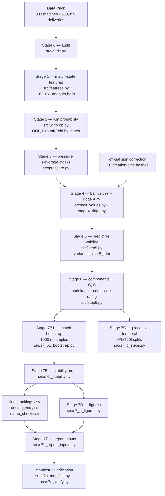

# SupeRR Selector Season 2 — Most Reliable Players Under Pressure

A reproducible ranking of T20 batters and bowlers by how reliably they perform when
the match is at its most decisive, measured against their own normal level rather
than against raw run or wicket counts.

**Status: all stages 0–8 complete, plus a Stage 7C verification pass (2026-11-15).**
`py -m pytest tests/ -q` → **97 passed**. No number in this README, or in any report
file, is typed by hand: every figure is regenerated from saved outputs.

The full task specification is [`PRD_Pressure_Players.md`](PRD_Pressure_Players.md).
Every methodological decision, including the ones that were reversed, is recorded in
[`DECISIONS.md`](DECISIONS.md).

---

## 1. What the project produces

| Artefact | Path | Content |
|---|---|---|
| **File of record** | `outputs/final_rankings.csv` | 30 rows (15 bowlers, 15 batters) × 50 columns: final rank, reserve flag, bootstrap median/interval/P(top 10), all component values, exposure, sample warnings |
| Submission text | `outputs/unstop_entry.txt` | Top 10 + reserves per role, with P/C/S, n_eff, matches, median rank, P(top 10) |
| Report source | `outputs/report_inputs.md` | 704 lines assembled from saved CSVs only — no hand-entered numbers |
| Name audit | `outputs/name_check.csv` | Registry name vs ball-by-ball name for all 30 ranked players; no spelling conflicts |
| Integrity | `outputs/tables/freeze_manifest.csv`, `freeze_manifest_pre_step4.csv`, `official_sign_correction_manifest.csv` | 71 + 7 + 18 rows of SHA-256 hashes with explicit status |
| Figures | `outputs/figures/*.png` | 15 plots: 5 Stage 7, 4 leverage/LI, 2 WP, 2 expected-vs-actual, 2 high-vs-ordinary |
| Tests | `tests/` | 97 tests across 13 files |
| Final PDF | `outputs/Methodology_Report.pdf` | **not produced** — deliberately out of scope |

## 2. Headline result

Final order = **ascending bootstrap median rank** over 1,000 match resamples, ties
broken by higher P(top 10), then higher primary-spec rating. Ranks 11–15 are reserves.

**Bowlers**

| # | Player | Median rank | 95% interval | P(top 10) | n_eff | Matches |
|---:|---|---:|---|---:|---:|---:|
| 1 | Rashid Khan | 1 | 1–8 | 0.989 | 1274 | 117 |
| 2 | Sunil Narine | 4 | 1–17 | 0.912 | 754 | 63 |
| 3 | Wanindu Hasaranga | 6 | 1–28 | 0.793 | 884 | 81 |
| 4 | Kuldeep Yadav | 6 | 1–55 | 0.666 | 865 | 84 |
| 5 | Axar Patel | 7 | 1–36 | 0.669 | 1249 | 126 |
| 6 | Bhuvneshwar Kumar | 7 | 1–73 | 0.589 | 519 | 94 |
| 7 | Josh Hazlewood | 11 | 1–63 | 0.485 | 521 | 57 |
| 8 | Mark Adair | 12 | 2–56 | 0.434 | 238 | 33 |
| 9 | Jasprit Bumrah | 13 | 2–65 | 0.406 | 603 | 69 |
| 10 | Mujeeb Ur Rahman | 14 | 2–58 | 0.378 | 342 | 35 |
| 11–15 | Abrar Ahmed, Shaheen Afridi, Mustafizur Rahman, Taskin Ahmed, Sikandar Raza | | | | | reserves |

**Batters**

| # | Player | Median rank | 95% interval | P(top 10) | n_eff | Matches |
|---:|---|---:|---|---:|---:|---:|
| 1 | Abhishek Sharma | 3 | 1–24 | 0.858 | 911 | 94 |
| 2 | Tim David | 4 | 1–19 | 0.888 | 332 | 91 |
| 3 | Suryakumar Yadav | 4 | 1–18 | 0.881 | 1258 | 124 |
| 4 | Vaibhav Sooryavanshi | 6 | 1–20 | 0.819 | 304 | 26 |
| 5 | Phil Salt | 6 | 1–25 | 0.802 | 612 | 60 |
| 6 | Virat Kohli | 6 | 1–20 | 0.769 | 1158 | 78 |
| 7 | Jos Buttler | 8 | 1–37 | 0.615 | 959 | 102 |
| 8 | Yashasvi Jaiswal | 10 | 2–41 | 0.517 | 802 | 57 |
| 9 | Heinrich Klaasen | 10 | 1–37 | 0.505 | 507 | 69 |
| 10 | Namboori Tilak Varma | 12 | 2–50 | 0.419 | 884 | 111 |
| 11–15 | Shreyas Iyer, Glenn Maxwell, Mitchell Marsh, Rinku Singh, Nicholas Pooran | | | | | reserves |

Top-10 overlap with the 72-variant consensus order: **bowlers 6/10, batters 9/10**.

---

## 3. Pipeline



### How the bootstrap actually works

```mermaid
flowchart LR
    M["766 analysis-ready matches"] -->|"rng.choice(..., replace=True)<br/>size = 766"| S["resample"]
    S -->|"value_counts()"| W["multiplicity per match<br/>0 … 8"]
    W -->|"ball weight × multiplicity"| R["refit P (ridge, multiplicity<br/>as sample weight), C, S"]
    R --> T["rank 131 batters / 133 bowlers<br/>(fixed population)"]
    T --> U["1000 ranks per player"]
    U --> V["integer median · 2.5/97.5 quantiles<br/>P(top 10) · P(top 5)"]
    V --> X["final order"]
```



The draw is **with replacement over matches**. A given resample contains 461–509
distinct matches of 766, omits 257–305, and repeats some matches up to 4–8 times;
mean distinct = 484.37, against the theoretical 766·(1−1/e) = 484.3.

### Stage map

| Stage | Command | Key output |
|---|---|---|
| 0 audit | `py -m src.audit` | `data_audit.md` |
| 1 features | `py -m src.features` | `features.parquet` |
| 2 win probability | `py -m src.innings1_compare`, `py -m src.winprob` | `wp_ball.parquet`, fold models |
| 3 pressure | `py -m src.pressure` | `pressure_ball.parquet` |
| 4 ball values + ridge | `py -m src.ball_values`, `py -m src.stage4_ridge` | `ball_values.parquet`, `player_metrics_*.csv` |
| 5 shrinkage | `py -m src.step5` | `step5_*.csv`, `variant_weights_B_trim.parquet` |
| 6 rating | `py -m src.step6` | `step6_*.csv`, `final_rating_candidates_*.csv` |
| 7B bootstrap | `py src/s7_b1_bootstrap.py` | `s7_bootstrap_ranks.csv` (264,000 rows) |
| 7B stability | `py src/s7b_stability.py` | `final_rankings.csv`, `unstop_entry.txt` |
| 7C validation | `py src/s7_c_steps.py` | placebo, temporal, role splits |
| 7D figures | `py src/s7_d_figures.py` | 5 Stage 7 PNGs |
| 7E report | `py src/s7b_report_inputs.py` | `report_inputs.md` |
| manifest | `py src/s7b_manifest.py` | `freeze_manifest.csv` |
| verification | `py src/s7c_verify.py` | read-only PASS/FAIL audit |

---

## 4. Stage detail

### 4.1 Data universe (Stage 0–1)

- 883 matches, 867 with deliveries, 200,999 deliveries.
- **Competition scope: IPL 2022–2026 and T20I 2022–2026 only.** Two other T20
  competitions in the pack (Emerging Teams Asia Cup, Asia Cup Rising Stars) are excluded.
- 853 matches in scope → **766 analysis-ready** (351 IPL, 415 T20I) after removing
  abandoned/no-result, tied/super-over, DLS/shortened and incompletely recorded matches.
- 183,167 deliveries in the main analysis set; 184,930 in the sensitivity set
  (tied matches' regulation balls retained but flagged).
- Verified data facts: `ball_by_ball.runs` is runs **off the bat**; `Overstep` and
  `other` are no-ball families; `over_ball_num` can exceed 6; only player 4458
  (`AHT Donald`) has a different registry and display name.
- Impact players: 558 on/off markers each, 185 players, 291 IPL matches.

### 4.2 Win probability (Stage 2)

Out-of-fold predictions only (GroupKFold by match, 5 folds).

| Innings | Model | Log loss | Brier | AUC | ECE |
|---|---|---:|---:|---:|---:|
| 1 | logistic + cubic splines (**chosen**) | 0.6354 | 0.2225 | 0.6901 | 0.0195 |
| 1 | LightGBM (rejected) | 0.6421 | 0.2250 | 0.6816 | 0.0197 |
| 2 | A_current logistic + splines | 0.4000 | 0.1305 | 0.8971 | — |
| 2 | B_interactions (best log loss) | 0.3985 | 0.1302 | 0.8978 | — |
| 2 | **D_lgb_mono (chosen)** | 0.4144 | 0.1363 | 0.8888 | 0.0187 |

Innings 1 uses logistic-splines on merit. Innings 2 uses the **monotone LightGBM**
(Model D) even though it costs +0.014 log loss versus A_current: chases require a
model whose probability cannot fall when fewer runs are needed from more balls, and
the monotone constraint is enforced rather than hoped for. That trade is deliberate
and is the reason the freeze manifest pins `wp_innings2_lightgbm_mono.joblib`.

Venue par was deliberately kept out of the WP features: it is constant within a
match, and trees memorised match identity (train AUC 0.97, OOF 0.61). Venue strength
enters the Stage 4 expected-runs model instead.

Innings-1 calibration compresses at the top (predicted ≈0.80, observed ≈0.748).
Reported, not corrected.

### 4.3 Pressure / leverage (Stage 3)

`LI(s) = Σ_o P(o | s) · |WP_after(s,o) − WP_before(s)|`, with `WP_before` from the
saved OOF prediction, `WP_after` from the *fold model* of the match's fold, and
`P(o | s)` from training-fold deliveries in the same innings × phase × wicket bucket ×
situation bucket cell (100-ball minimum, hierarchical fallback). LI never uses player
identity and never crosses the innings break.

- Main version: LI normalised by its innings mean, so league mean LI = 1.0 per innings.
- HIGH = top quartile within innings: **45,793 balls (25.0%)**; ORDINARY = bottom half.
- Variants tested: pooled quartile (45,800), tercile (61,057), LI>1.5 (22,049), LI>2 (9,892).
- Cross-check against a transparent 0–1 scorecard-pressure composite: Spearman
  **+0.201** (innings 1), **+0.597** (innings 2).
- State-adjusted validation: death-over high-leverage batting is *aggressive*
  (+2.15 runs per 100 balls), and adjusted wickets rise under pressure in chases.
- Known asymmetry, reported as a limitation: 54% of innings-1 high-pressure balls fall
  in the powerplay, only 4% in middle overs.

### 4.4 Ball values and the ridge (Stage 4)

- `WPAE = actual WPA − Σ_k p_out_k · (WP_after,k − WP_pre)`; **y_bat = WPAE**,
  **y_bowler = −y_bat** (corr = −1.0000, exact by construction).
- Design: `y = intercept + batter + bowler + phase + innings + competition + error`,
  fitted by `Ridge(alpha=10000, solver="lsqr")` with sample weights, encoder fitted on
  training matches only, coefficients centred so zero = average player.
- Alpha chosen by 5-fold GroupKFold by match; held-out players get no player effect.
- **Honest result:** CV weighted MSE 0.005561 vs a no-player-effects baseline 0.005560
  — an "improvement" of −1.2e-06. Player effects are weak. APV differences are
  provisional and are treated that way downstream (shrinkage, bootstrap intervals).
- APV per 100 pressure-weighted balls is a rescaling, not a ratio; RR = APV_pressure −
  APV_ordinary; CON is reported as separate components, never folded into a single number.

### 4.5 Predictive validity and variant choice (Stage 5)

Every predictor is estimated inside one half of the data and tested on the other
(odd/even and early/late by match date).

- Raw pressure mean and CON share/median carry the only consistent signal for batters
  (mean Spearman ≈0.10–0.15 vs raw value, 0.18–0.22 vs CON median).
- For bowlers, ridge-based predictors are consistently *negative* against the raw
  target (−0.03 to −0.20); only CON share/median retain a weak positive relation.
- Variant chosen by a rule fixed in advance (higher mean split-half Spearman per role):
  **B_trim** for both roles (batters 0.1175 vs 0.0949; bowlers 0.1096 vs 0.0992).
- Shrinkage: `B_i = signal_var / (signal_var + se_i²)`, signal variance estimated by
  method of moments with a 1,000-resample player bootstrap CI. Split-half covariances
  are an order of magnitude smaller and negative for bowlers, so shrinkage is used as a
  sensitivity device, **not** as validated precision weighting.

### 4.6 Components and rating (Stage 6)

| Component | Definition | Gate (mean Spearman) |
|---|---|---|
| **P** — pressure level | shrunk pressure-weighted WPAE | batters 0.125, bowlers 0.129 |
| **C** — consistency | mean of z(positive share), z(median per-match value) | batters 0.154, bowlers 0.183 |
| **S** — overall skill | ridge APV on all balls (alpha 1e4) | batters 0.128, bowlers 0.182 |

All six gates pass, so nothing is dropped. `rating = mean of z(P), z(C), z(S)` under
equal weights for the primary spec; the 72-variant grid crosses 2 variants (B, B_trim) ×
3 eligibility thresholds × 4 weight specs (equal, P/C/S-heavy) × 3 alphas
(1e3/1e4/1e5) and is retained only as sensitivity.

- Cluster signal variance: batters 0.000015 (floored from 0.000793), bowlers 0.000001.
- Median shrinkage among eligible players: batters 0.593, bowlers 0.050 — **bowler
  ratings are shrunk very hard**, which is why the bowler order is so bootstrap-unstable.
- 72-variant agreement: batters min pairwise Spearman 0.822 (median 0.931); bowlers
  min −0.031 (median 0.614). Bowler rankings depend on variant choice; the stability
  rule exists precisely because of this.

### 4.7 Bootstrap and the stability rule (Stage 7B)

- 1,000 match resamples, seed 42, primary spec only (B_trim, n_eff ≥ 150, ≥ 15 matches,
  equal weights, alpha 1e4, Step 6 shrink factors and signal variance held fixed).
- Per resample: draw 766 matches with replacement → multiplicity-weighted ball weights →
  refit P and S → recompute C → rating → rank the **fixed** 131/133 player population.
- Per player: integer median rank, 2.5/97.5 interval (`higher`), P(top 10), P(top 5),
  and P(top 10) restricted to n_eff ≥ 200.
- **Decision:** final rank = ascending bootstrap median, ties by P(top 10), then rating.
  Reason: the 72-variant consensus put Piyush Chawla 6th while his bootstrap median was
  34 with P(top 10) 0.05 and only 12 high-pressure balls. Exposure-aware stability is the
  defensible order; consensus is kept as `consensus_rank_72`.

### 4.8 Robustness checks (Stage 7C)

| Check | Result | Reading |
|---|---|---|
| Placebo (100 within-innings×phase weight permutations) | Real beats placebo on early/late for batters (share placebo ≥ real = 0.06–0.12) and for bowler C on odd/even (0.01), but **not** on odd/even for batters (0.87, 0.65) | Mixed — the pressure weighting is not reliably better than a placebo on every split |
| Temporal holdout (fit <2025, validate ≥2025; 459/307 matches) | rating vs late raw APV ρ = 0.09 (bat), 0.13 (bowl); vs late CON median ρ = 0.12 (bat), 0.38 (bowl) | Weak-to-moderate persistence; early top-10 mean later value CI includes 0 |
| IPL-only rerun | top-10 overlap with stability top 10: batters 7, bowlers 7 | Order survives competition restriction |
| T20I-only rerun | batters 6, bowlers 5 | T20I samples are thin; four T20I bowlers remain top 15 |

These are the least flattering results in the project and they are reported as they
came out. The ranking is a descriptive stability summary, not a validated forward
prediction.

---

## 5. The sign-convention episode (the central bug)

This is the one defect that changed the answer, so it is documented in full.

**Symptom.** Bowler `ridge_apv` and bowler `raw_apv` correlated **+0.87** — with 87.3%
of bowlers sharing a sign — although `y_bowler = −y_bat` exactly. The two quantities
were supposed to point in opposite directions. The published top-10 bowlers were
Tanzim Sakib, Anrich Nortje, Arshdeep Singh, Andre Russell, … i.e. **the worst bowlers
in the dataset, ranked as the best**.

**Cause, in two layers.**

1. The ridge is fitted on `y_bat`. A good bowler *lowers* `y_bat`, so the fitted bowler
   coefficient is negative for good bowlers. Negating it is what makes "higher = better".
   `raw_apv` = mean of `y_bowler` = mean of `−y_bat`, which is already "higher = better".
2. The cached `step6_half_components.csv` had been produced before that negation was in
   the code (file mtime 16:30, `src/step6.py` 19:20). Everything downstream that consumed
   the half cache inherited the unnegated direction.

**Diagnosis evidence.**

- `corr(y_bat, y_bowler) = −1.0000`.
- Sign contingency for bowlers: 1,528 same-positive, 1,729 same-negative, 472 opposite
  (P(same) = 0.8734) — impossible if directions were correct.
- Recomputed half coefficients vs cache: correlation **−1.0** for bowler ridge, +1.0 for
  raw — proof the cache was stale, not a modelling difference.
- Synthetic experiment (seed 20261114, 48,000 balls, known true effects): before
  correction corr(estimate, true quality) = **−0.996**; after negation **+0.996**.
- Split-half reliability is *invariant to negation* (both halves flip, correlation
  unchanged), so the healthy 0.83–0.89 split-half rho never validated direction. A test
  that asserted "bowler same-half correlation is positive" was therefore wrong: the
  assertion was corrected to `< 0`, not weakened, and 7 new tests pin the convention.
- Impact: top-10 overlap before vs after = **0/10**, Spearman of the two orders = **−1.0**.
  The corrected order agrees with raw bowler APV at ρ = +0.848.

**Fix.** `bowler_APV (higher = better) = −(centred fitted coefficient on y_bat)`, applied
exactly once, in one place. `raw_apv` untouched. Batter path untouched. The 18 files
produced at correction time are pinned in
`outputs/tables/official_sign_correction_manifest.csv`; all 18 still match.

Full write-ups: [`FINAL_BOWLER_SIGN_INVESTIGATION.md`](FINAL_BOWLER_SIGN_INVESTIGATION.md),
[`BOWLER_SIGN_CORRECTION_IMPACT_REPORT.md`](BOWLER_SIGN_CORRECTION_IMPACT_REPORT.md),
[`SIGN_CONVENTION_REPORT.md`](SIGN_CONVENTION_REPORT.md).

---

## 6. Verification status (2026-11-15)

Independent, read-only checks in `src/s7c_verify.py` plus `tests/`.

| Check | Status | Evidence |
|---|---|---|
| Sampling with replacement | **PASS** | `replace=True`, n = 766; 461–509 distinct per resample; duplicates = omissions (257–305); mean distinct 484.37 vs 484.3 expected |
| Seed reproducibility | **PASS** | `RandomState(42)` replays identically; resamples 0 and 1 rebuilt end-to-end with 0 rank mismatches |
| Match multiplicity weighting | **PASS** | weights × multiplicity; identity check exact (304,671.583804 both sides); multiplicities 1–8 |
| Fixed player population | **PASS** | 131 batters / 133 bowlers present in all 1,000 resamples; no artificial ranks |
| Bootstrap statistics | **PASS** | integer median, 2.5/97.5 (`higher`), P(top 10), P(top 5) reproduce stored values |
| Final ranking consistency | **PASS** | 0 order and 0 column mismatches, both roles, including reserves 11–15 |
| Historical manifest integrity | **PARTIAL** | 25 files have authentic baselines and all match; **44 have no recoverable baseline** |
| Full test suite | **PASS** | 97 passed, exit 0 |

Manifest states, kept strictly distinct:

| State | Files |
|---|---|
| Verified against an authentic pre-Step-4 baseline | 7 |
| Verified against the sign-correction creation manifest | 18 |
| Hash mismatch / file missing | **0** |
| Current hash recorded, no historical baseline exists | **44** (Stage 4–6 outputs) |
| Stage 7 outputs, labelled as such (not historical) | 20 |

The 44 rows are marked "current hash only (no historical baseline)" and are **never**
described as verified. Their stored hashes were refreshed once during the verification
session and no backup exists; that is recorded rather than hidden.

---

## 7. Failure log — what went wrong, what it cost, what fixed it

| # | Failure | Impact | Resolution |
|---:|---|---|---|
| 1 | 11 matches had a rain-truncated innings with no DLS/revised flag | Corrupted chase features | Detected by an innings-completeness rule (all balls used, all out, or target reached); excluded permanently |
| 2 | Venue par inside WP features | Train AUC 0.97, OOF 0.61 — memorised match identity | Removed from WP; venue strength moved to the Stage 4 expected-runs model |
| 3 | LightGBM innings-1 candidate | Worse on all four metrics | Rejected in favour of logistic-splines |
| 4 | Innings-2 monotone LightGBM | Costs +0.014 log loss vs plain logistic | Kept deliberately for monotonicity; documented, not hidden |
| 5 | **Stale half-component cache built before the bowler negation** | Published bowler top 10 were the worst bowlers; overlap 0/10 with the correct order | Cache detected by mtime + −1.0 recompute correlation; convention fixed in one place; 18 files re-issued under a hash manifest |
| 6 | Undocumented sign convention for bowler APV | Two contradicting directions in one pipeline | Written down as `−coefficient`, synthetic test + sign contingency as proof |
| 7 | Split-half reliability read as evidence of correct sign | A test asserted a positive bowler correlation | Corrected to `< 0`; invariance-to-negation explained in the reports |
| 8 | `step6_half_components.csv` stored truncated (only batter-B, bowler-B_trim) | Half-based metrics could not be reconciled | All four role × variant frames rebuilt to `step6_half_components_rebuilt2.csv` |
| 9 | Stage 4 bootstrap covered only top 40 per role | Over-confident intervals | Replaced by the Stage 7 full-population match bootstrap |
| 10 | Stage 4 CV improvement over a no-player baseline is ≈0 (−1.2e-06) | Player effects are weak; APV noise dominates | Kept, reported plainly, and answered with shrinkage + stability intervals |
| 11 | 44 historical hashes had no baseline and were refreshed once | Historic integrity unprovable | Recorded as PARTIAL, never as verified |
| 12 | Ambiguous wording "every resample is a permutation of 1..n" | Looked like rank-permutation sampling | Clarified: it describes the ranks within a resample, not the draw; verification proves the draw is with replacement |
| 13 | Verification script used `.resample` as an attribute | Hit pandas' `Resampler` accessor | Use `ranks["resample"]` |
| 14 | Verification script grouped by `player_id` only | 21 dual-role players merged → "152 batters" | Group by `["role", "player_id"]` |
| 15 | Verification script joined a concatenated ratings frame with duplicate ids | Merge duplicated rows → 152/154 again; false order mismatches | Map ratings per role instead of merging |
| 16 | Innings-1 calibration compresses at high probability | Over-confident at WP ≈0.80 (observed 0.75) | Reported as a limitation; propagates into WPA/LI by construction |

Items 13–15 were bugs in my own verification code, caught because the check printed
131/133 and 152/154 in the same run and refused to agree with itself. The pipeline
outputs were never changed by them.

---

## 8. Limitations, stated plainly

- **Player effects are weak.** Ridge CV error is indistinguishable from a model with no
  player terms; per-ball WPAE is extremely noisy. Rankings describe observed pressure
  performance, not projected future performance.
- **Bowler signal variance is floored** (0.000001) because split-half covariance is
  negative; bowler shrinkage is therefore weakly identified, and bowler order is
  variant-sensitive (72-variant pairwise Spearman down to −0.03).
- **The pressure weighting does not beat a placebo on every split** (odd/even for
  batters: 87% of placebo draws do at least as well).
- **Temporal persistence is weak** (ρ ≈0.09–0.13 against later raw values), with wide
  intervals; early top-10 mean later performance is statistically indistinguishable from 0.
- **Survivorship/selection bias**: eligibility requires sustained pressure exposure
  (n_eff ≥ 150 and ≥ 15 matches) plus a fully defined P/C/S rating. That leaves
  131 batters and 133 bowlers, against 154/154 who pass the exposure gate alone.
- **Bootstrap holds Step 6 shrink factors and signal variance fixed**; it resamples
  matches, not the model-selection uncertainty.
- **Small samples at the edge**: the final 30 all clear 100 high-pressure balls
  (`low_hp_sample = False` for all 30); players below that line were screened out earlier.
- **No pitch, weather, ball type, or batter-vs-bowler-type data**; T20I opposition
  strength varies and is only partly absorbed by the joint ridge.
- **Excluded by design**: 7 tied/super-over matches (sensitivity set), 11 incomplete
  matches (permanent), two non-IPL T20 competitions.
- **Innings-1 WP over-confidence** propagates into WPA and LI.
- **`step6_half_components.csv` is superseded** by `rebuilt2` and is kept only for provenance.

---

## 9. Reproducibility

Python 3.13.12 on Windows 11. Pinned versions in `requirements.txt`
(pandas 2.3.3, numpy 2.4.2, scipy 1.17.1, scikit-learn 1.8.0, lightgbm 4.7.0,
matplotlib 3.10.8, pyarrow 23.0.1, pytest 9.2.0).

```bash
py -m pip install -r requirements.txt
```

Seeds: pipeline `SEED = 42` (`src/config.py`); Stage 7 bootstrap 42; placebo
permutations seeded per draw (1000 + i); temporal bootstrap CI 42.

Exact run order used to produce the file of record:

```bash
py -m src.audit
py -m src.features
py -m src.innings1_compare
py -m src.revert_innings1          # only because logistic was selected
py -m src.winprob
py -m src.pressure
py -m src.ball_values
py -m src.stage4_ridge
py -m src.stage4_report
py -m src.step5
py -m src.step5_report
py -m src.step6
py src/s7_b1_bootstrap.py          # ~10 min, 1000 resamples
py src/s7_fill_rankings.py
py src/s7_a2_rebuild.py
py src/s7_c_steps.py
py src/s7b_stability.py
py src/s7_d_figures.py
py src/s7b_report_inputs.py
py src/s7b_manifest.py
py src/s7c_verify.py               # read-only audit
py -m pytest tests/ -q
```

Runtime notes: the bootstrap is the only slow step (~10 minutes). `s7c_verify.py` is
read-only and takes about a minute; it never writes a ranking or a hash.

---

## 10. Repository layout

```
RR_challange/
  Data Pack/                       raw inputs (never modified)
  PRD_Pressure_Players.md          task specification
  README.md                        this file
  DECISIONS.md                     chronological decision + failure log
  SIGN_CONVENTION_REPORT.md        sign reconciliation analysis
  BOWLER_SIGN_REPORT.md            sign investigation
  BOWLER_SIGN_CORRECTION_IMPACT_REPORT.md
  FINAL_BOWLER_SIGN_INVESTIGATION.md
  requirements.txt
  src/
    config.py                      paths, seed, domain constants
    load_clean.py                  loaders, completeness and exclusion flags
    audit.py                       Stage 0
    features.py                    Stage 1
    winprob.py                     Stage 2 (+ innings1_compare, revert_innings1)
    pressure.py                    Stage 3
    ball_values.py                 Stage 4 ball values
    stage4_ridge.py                Stage 4 design matrix, fit, player effects
    stage4_report.py               Stage 4 report
    step5.py, step5_report.py      Stage 5
    step6.py                       Stage 6 components, gate, rating
    s7_b1_bootstrap.py             Stage 7B bootstrap
    s7b_stability.py               stability order, final_rankings, unstop
    s7_a2_rebuild.py               A2 sign check + rebuilt2
    s7_c_steps.py                  placebo, temporal, role splits
    s7_d_figures.py                Stage 7 figures
    s7b_report_inputs.py           report_inputs.md
    s7b_manifest.py                freeze manifest
    s7c_verify.py                  read-only verification audit
    official_sign_correction.py    sign correction + 18-file manifest
  tests/                           97 tests, 13 files
  outputs/
    final_rankings.csv             file of record (30 x 50)
    unstop_entry.txt               submission text
    name_check.csv                 name audit
    report_inputs.md               704-line report source
    features.parquet
    tables/                        165 CSV/Parquet artefacts + 4 stage reports
    figures/                       15 PNGs
    models/                        frozen WP models (fold + full data)
    logs/                          run logs per stage
  app/                             optional dashboard (unused)
```

`outputs/backup_*`, `outputs/checkpoints` and `outputs/models_backup` hold pre-correction
snapshots kept for provenance.

---

## 11. Tests (97)

| File | Covers |
|---|---|
| `test_load_clean.py` | schema, exclusions, completeness, scorecard reconstruction, target logic |
| `test_features.py` | feature construction, leakage guards, chase target, dismissal crediting |
| `test_winprob.py` | probability validity, WPA signs, terminal WPA, calibration, fold integrity, `y_bowler = −y_bat` |
| `test_pressure.py` | LI bounds, within-innings normalisation, outcome-probability sums, side labels, SPS |
| `test_stage4.py`, `test_step4.py` | ball-value validation, ridge design, alpha path, eligibility |
| `test_step5.py` | split-half construction, predictive validity, variant rule |
| `test_step6.py` | gating reproduced from CSV, signal-variance floor, rating = mean of gated z-scores, ranking uniqueness |
| `test_bowler_sign_convention.py` | bowler negation applied exactly once; split-half sign; synthetic recovery |
| `test_bowler_sign_reconciled.py`, `test_bowler_sign_final_audit.py` | corrected vs original orders, overlap 0/10, frozen-file preservation |
| `test_step7.py` | bootstrap counts, rank permutation within a resample, weight multiset, final ranking recomputation, half-frame signs, protected hashes |
| `test_bootstrap_sampling.py` | with-replacement vs permutation draws, omissions, seed replay, integer multiplicities, fixed population |

---

## 12. Glossary

- **LI** — leverage index: expected absolute win-probability swing of the next ball.
- **WPAE** — win-probability added over expectation; the ball value used for players.
- **APV** — adjusted pressure value, the centred ridge player effect.
- **RR** — pressure minus ordinary APV (a difference, not a ratio).
- **CON** — consistency: positive share and median per-match pressure value.
- **P / C / S** — pressure level, consistency, overall skill; the three rating components.
- **n_eff** — effective sample size, `(Σw)² / Σw²`, using the variant's LI weight.
- **HIGH / ORDINARY** — top within-innings LI quartile / bottom half.
- **B_trim** — the chosen pressure weight variant (LI-weighted, trimmed), selected in Stage 5.
- **Stability rank** — ascending bootstrap median rank, ties by P(top 10) then rating.
